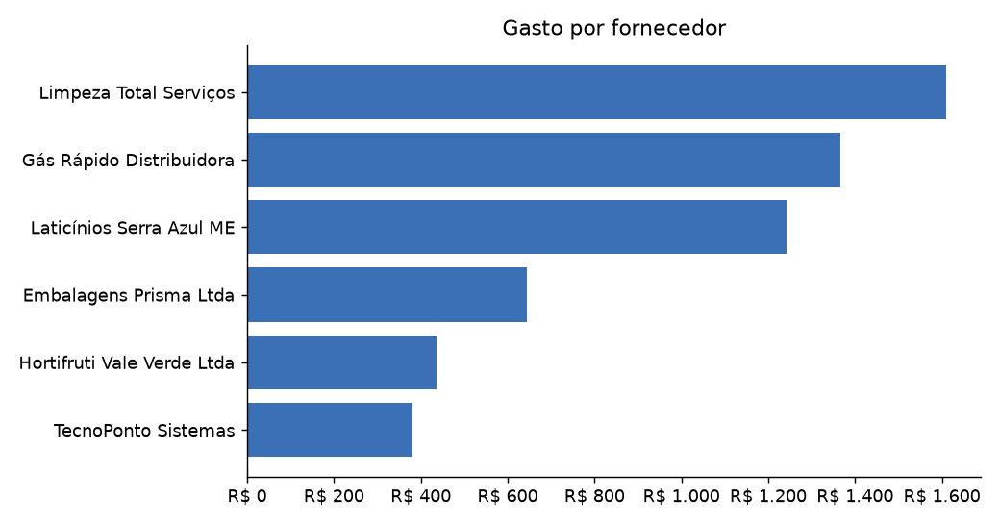
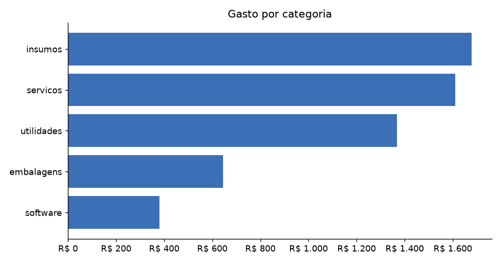
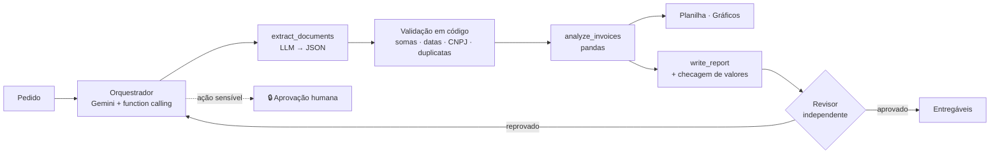
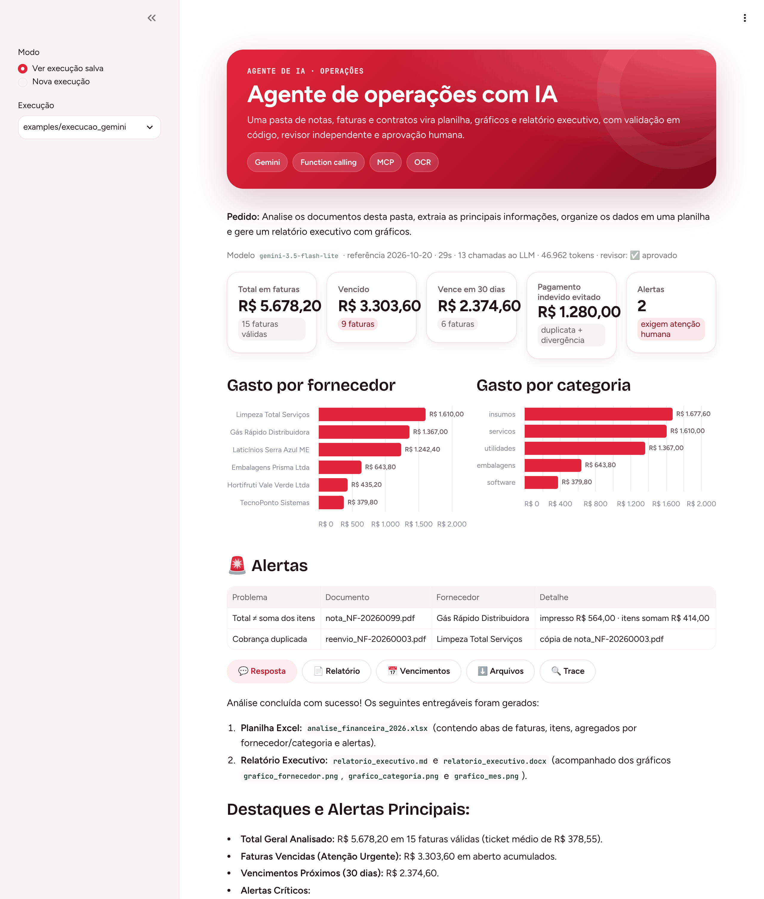

# 🗂️ AI Business Operations Agent

**Um agente de IA que recebe um pedido em português e transforma uma pasta de documentos financeiros (notas fiscais, faturas, cobranças por e-mail, contratos) em planilha consolidada, gráficos e relatório executivo, apontando duplicatas, cobranças divergentes e vencimentos.**

> "Analise os documentos desta pasta, extraia as principais informações, organize os dados em uma planilha e gere um relatório executivo com gráficos."

[](https://github.com/henriquecm02/ai-business-operations-agent/actions/workflows/tests.yml)


## O problema

Em uma pequena empresa, alguém passa horas por mês abrindo PDFs, Words e e-mails de cobrança, copiando valores para uma planilha, somando por fornecedor e tentando lembrar o que vence esta semana. Nesse processo, **cobranças duplicadas e totais errados passam despercebidos e viram pagamento indevido.**

**Usuário-alvo:** dono(a) ou responsável administrativo de pequena empresa, sem equipe de dados.

## O que o agente entrega

| Entregável | Conteúdo |
|---|---|
| `*.xlsx` | Abas: Faturas, Itens, Por fornecedor, Por categoria, Alertas |
| `grafico_*.png` | Gasto por fornecedor, categoria e mês |
| `relatorio_executivo.md` / `.docx` | Resumo, gastos, vencimentos, alertas e recomendações |
| `execucao.json` | Cada passo (ferramenta, argumentos, tempo, tokens), a análise, o parecer do revisor. O dashboard reabre a execução a partir dele |

Exemplo real gerado pelo agente (sem edição do texto do modelo): [`examples/relatorio_executivo.md`](examples/relatorio_executivo.md) · [planilha](examples/) · gráficos abaixo.

<p> </p>

## Como funciona



Princípios que guiaram as decisões (detalhes em [`docs/ARCHITECTURE.md`](docs/ARCHITECTURE.md)):

- **O LLM interpreta, o código calcula.** O modelo transforma texto em JSON. Somas, agrupamentos, duplicatas e datas são calculados em Python, e o relatório só pode citar números que existem na análise.
- **Checagem contra número inventado.** `write_report` compara cada "R$" do texto com os dados. Se um valor não existe, o agente recebe o aviso e reescreve.
- **Um agente + um revisor, e não cinco agentes.** Avaliei separar em agentes de Documentos, Dados, Workflow, Pesquisa e Revisão. Só o revisor justificou ser separado (contexto independente, menos autoconfirmação). O resto virou ferramenta: é mais barato, mais rápido e testável.
- **Humano no controle.** Ações com efeito externo (`send_email`) exigem aprovação, e o padrão é negar.
- **Dados ficam na sessão, não no prompt.** A planilha é gerada a partir dos registros extraídos, sem o modelo recopiar valores.

## Resultados medidos

Benchmark reproduzível (`bench/run_benchmark.py`) sobre 17 documentos sintéticos com respostas conhecidas ([`demo/data/ground_truth.json`](demo/data/ground_truth.json)), incluindo **uma nota duplicada e uma com total divergente plantadas de propósito**.

<!-- RESULTS:START -->
**Execução ponta a ponta do agente**: `gemini-3.1-flash-lite`, prompt de extração v2, data de referência 20/10/2026 ([dados brutos](bench/results/20261115-2122_gemini-3.1-flash-lite.json)):

| Métrica | Resultado |
|---|---|
| Entregáveis gerados (planilha, relatório MD + DOCX, gráficos) | ✅ todos |
| Problemas plantados detectados (duplicata, total divergente) | **2 de 2**, sem alarmes falsos |
| Valores em R$ no relatório sem respaldo nos dados | **0** |
| Acurácia dos campos extraídos (8 campos × 16 faturas + tipo do contrato) | **98,4%** |
| Tempo do pedido até os arquivos prontos | **28 s** (6 s de extração dos 17 documentos) |
| Chamadas ao LLM / tokens por execução | 12 / ~41 mil |
| Parecer do revisor | aprovado |

**Evolução medida**

| Versão | Campos | Itens | Alarmes falsos | Observação |
|---|---|---|---|---|
| Prompt v1 · `gemini-3.5-flash-lite` | 96,1% | 83,9% | 2 | o valor entre parênteses nos e-mails era lido como preço unitário ([dados](bench/results/20261115-2055_gemini-3.5-flash-lite.json)) |
| Prompt v2 · `gemini-3.1-flash-lite` | 98,4% | 83,9% | 0 | itens certos, mas a descrição vinha como "10x Alface" |
| v2 + normalização da descrição em código | 98,4% | **100%** | 0 | medido só na extração: 3 chamadas, 11 s ([dados](bench/results/20261115-2124_gemini-3.1-flash-lite_extracao.json)) |

**Erros que restam:** 2 de 129 campos. Os dois e-mails de cobrança dizem "referente ao pedido de 13/10/2026", e o modelo devolveu `data_emissao = null` em vez de supor que a data do pedido é a de emissão. É o comportamento pedido pelo prompt ("campo ausente: null, nunca invente"), e o relatório apontou essas faturas como "sem data de emissão". Mantive o ground truth como está para não ajustar o teste ao resultado.

> **Ressalvas:** cada linha é 1 execução (o plano gratuito do Gemini limita as requisições diárias), e o conjunto tem 17 documentos sintéticos. A v1 rodou numa versão anterior dos dados, em que os nomes de fornecedores tinham o sufixo "(fictícia)". Os números indicam a tendência, não são uma estatística robusta. `python bench/run_benchmark.py --rodadas 5` repete a medição.
<!-- RESULTS:END -->

### O que o benchmark ensinou (prompt v1 → v2)

Na primeira rodada, o validador marcou dois e-mails de cobrança como "total divergente". Investigando, descobri que o modelo lia `10x Alface (R$ 31,00)` como preço unitário de R$ 31,00, e não como subtotal. **A validação em código impediu que o erro virasse um número errado no relatório**: ela sinalizou uma inconsistência em vez de somar R$ 310,00. Corrigi na origem com o prompt de extração `v2` (regra explícita para listas em texto e `preco_unitario` opcional). Os dois prompts ficam versionados em [`src/opsagent/prompts/`](src/opsagent/prompts/) e podem ser comparados pelo benchmark.

### Manual vs. automatizado

Não publico estimativa de "horas economizadas" sem medir. Para comparar, cronometre você mesmo o processo manual com a mesma pasta (abrir os 17 documentos, montar a planilha, somar por fornecedor, achar a duplicata e a divergência, escrever o resumo) e compare com o tempo do agente na tabela acima. [`bench/PROTOCOLO_MANUAL.md`](bench/PROTOCOLO_MANUAL.md) descreve o passo a passo.

## Como rodar

```bash
git clone https://github.com/henriquecm02/ai-business-operations-agent.git
cd ai-business-operations-agent
python -m venv .venv && source .venv/bin/activate
pip install -e ".[ui,mcp,dev]"
cp .env.example .env   # coloque sua GEMINI_API_KEY (gratuita em aistudio.google.com)
```

**Linha de comando**

```bash
opsagent --data-referencia 2026-10-20          # usa a pasta demo/data/inbox
opsagent "Quais fornecedores vencem esta semana? Gere só a planilha." --entrada ~/minhas_notas
```

**Dashboard**

```bash
streamlit run app/streamlit_app.py
```

Dois modos: **Nova execução** (roda o agente e acompanha cada passo ao vivo) e **Ver execução salva**, que reabre qualquer `execucao.json` de `examples/` ou `runs/` com indicadores, gráficos, alertas, relatório e trace, **sem precisar de chave de API**.



> Captura do modo "Ver execução salva" com uma **execução real** do agente no Gemini (`gemini-3.5-flash-lite`, 13 chamadas, 29 s), salva em [`examples/execucao_gemini/`](examples/execucao_gemini/). Ela fecha com o gabarito dos dados de demonstração: 15 faturas válidas somando R$ 5.678,20 e os 2 problemas plantados (a cobrança duplicada e o total divergente), sem falso alerta. É uma única execução, não um benchmark; os números medidos estão na seção de resultados.

**Servidor MCP** (Claude Desktop, Claude Code ou qualquer cliente MCP)

```json
{
  "mcpServers": {
    "business-ops": {
      "command": "/caminho/.venv/bin/opsagent-mcp",
      "args": ["--entrada", "/caminho/notas", "--saida", "/caminho/saida"],
      "env": { "GEMINI_API_KEY": "..." }
    }
  }
}
```

**Testes** (sem rede: um LLM falso roteiriza o agente)

```bash
pytest -q
```

**Benchmark** (usa o LLM real)

```bash
python bench/run_benchmark.py --rodadas 3
OPSAGENT_PROMPT_EXTRACT=v1 python bench/run_benchmark.py   # compara versões de prompt
```

> **Plano gratuito do Gemini:** cada modelo tem um limite diário de requisições. A extração é feita em lotes (6 documentos por chamada) para que uma execução completa use cerca de 10 a 13 requisições. Quando a cota acaba, o agente mostra uma mensagem clara em vez de um erro.

## Estrutura

```
src/opsagent/
  agent.py         orquestrador, aprovação humana, revisor, trace
  tools.py         ferramentas (também expostas via MCP)
  extraction.py    LLM → JSON em lotes + validação determinística
  analysis.py      agregações em pandas (fonte única dos números)
  outputs.py       planilha, gráficos, relatório, checagem de valores
  llm.py           interface de LLM, adaptador Gemini, LLM roteirizado para testes
  mcp_server.py    servidor MCP (tools, resource, prompt)
  prompts/         prompts versionados (system, extract v1/v2, reviewer)
app/               interface Streamlit
bench/             benchmark e resultados
demo/              gerador de documentos sintéticos e ground truth
tests/             testes offline
```

## Documentos escaneados e envio real de e-mail

**OCR.** Quando um PDF não tem texto embutido (menos de 30 caracteres), ele é convertido em imagem a 300 dpi e lido pelo Tesseract em português. O texto chega ao modelo do mesmo jeito, mas a extração marca o documento com `lido_por_ocr`, e a leitura avisa o agente para conferir números e CNPJ no original. Sem o Tesseract instalado, o erro diz exatamente o que instalar.

Para medir o OCR sem LLM, `demo/generate_scanned.py` gera 6 notas "escaneadas" (tons de cinza, rotação, ruído e resolução menor), e `bench/ocr_eval.py` confere quantos campos do gabarito aparecem no texto lido ([resultados](bench/results/ocr_escaneados.md)):

| Qualidade do scan | Campos lidos corretamente |
|---|---|
| 200 dpi, rotação até 0,9°, pouco ruído (2 notas) | 17/17 |
| 150 dpi, rotação até 1,6°, ruído médio (2 notas) | 14/14 |
| 100 dpi, rotação de 3°, ruído alto | 6/8 (errou CNPJ e vencimento) |
| 100 dpi, rotação de 2,5°, ruído muito alto | 0/7 |
| **Total** | **37/46 (80,4%)** |

Com scans de 150 dpi ou mais, todos os campos saem certos. Com 100 dpi e muito ruído, o OCR falha, e é por isso que o documento vem marcado para conferência.

**E-mail.** `OPSAGENT_EMAIL_BACKEND=smtp` liga o envio real por SMTP com STARTTLS, configurado por `SMTP_HOST`, `SMTP_PORT`, `SMTP_USER`, `SMTP_PASSWORD` e `SMTP_FROM` (veja `.env.example`). O padrão continua sendo `eml`, que só grava o arquivo. Nos dois modos, `send_email` segue como ação sensível: nada sai sem aprovação humana, e uma cópia `.eml` fica sempre na pasta de saída. O envio foi testado com um servidor SMTP falso, não com uma conta real.

## Limitações

- O OCR falha em scans de baixa resolução (100 dpi com muito ruído). PDFs com várias páginas escaneadas são lidos página a página, sem reconstruir tabelas.
- A extração de notas escaneadas pelo Gemini ainda não foi medida, só a leitura pelo OCR. Ela depende de uma chave de API.
- Os dados de demonstração são sintéticos e pequenos (17 documentos). Os números do benchmark valem para esse conjunto.
- O revisor é um LLM e pode deixar passar problemas. Na primeira execução real, ele aprovou um relatório com o mesmo fornecedor listado duas vezes (nomes escritos de formas diferentes). Corrigi agrupando por CNPJ, mas isso mostra por que as checagens críticas estão em código.

## Roadmap

- [x] OCR para documentos escaneados
- [ ] Integração com Google Drive (entrada) e Sheets (saída) via n8n
- [x] Envio real por e-mail (SMTP) com aprovação humana
- [ ] Medir a extração do Gemini nas notas escaneadas
- [ ] Avaliação do revisor com relatórios defeituosos plantados

---

Todos os fornecedores, CNPJs e valores dos dados de demonstração são **fictícios**.
Licença MIT.
