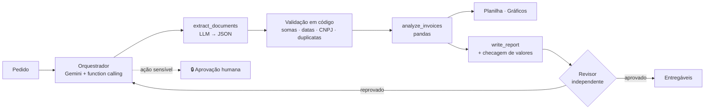

# 🗂️ AI Business Operations Agent

**Um agente de IA que recebe um pedido em português e transforma uma pasta de documentos financeiros (notas fiscais, faturas, cobranças por e-mail, contratos) em planilha consolidada, gráficos e relatório executivo, apontando duplicatas, cobranças divergentes e vencimentos.**

> "Analise os documentos desta pasta, extraia as principais informações, organize os dados em uma planilha e gere um relatório executivo com gráficos."

[](https://github.com/henriquecm02/ai-business-operations-agent/actions/workflows/tests.yml)


## O problema

Em uma pequena empresa, alguém passa horas por mês abrindo PDFs, Words e e-mails de cobrança, copiando valores para uma planilha, somando por fornecedor e tentando lembrar o que vence esta semana. Nesse processo, **cobranças duplicadas e totais errados passam despercebidos e viram pagamento indevido.**

**Usuário-alvo:** dono(a) ou responsável administrativo de pequena empresa, sem equipe de dados.

## O que o agente entrega

| Entregável | Conteúdo |
|---|---|
| `*.xlsx` | Abas: Faturas, Itens, Por fornecedor, Por categoria, Alertas |
| `grafico_*.png` | Gasto por fornecedor, categoria e mês |
| `relatorio_executivo.md` / `.docx` | Resumo, gastos, vencimentos, alertas e recomendações |
| `trace.json` | Cada passo: ferramenta, argumentos, tempo, tokens e o parecer do revisor |

Exemplo real gerado pelo agente: [`examples/`](examples/).

## Como funciona



Princípios que guiaram as decisões (detalhes em [`docs/ARCHITECTURE.md`](docs/ARCHITECTURE.md)):

- **O LLM interpreta, o código calcula.** O modelo transforma texto em JSON. Somas, agrupamentos, duplicatas e datas são calculados em Python, e o relatório só pode citar números que existem na análise.
- **Checagem contra número inventado.** `write_report` compara cada "R$" do texto com os dados. Se um valor não existe, o agente recebe o aviso e reescreve.
- **Um agente + um revisor, e não cinco agentes.** Avaliei separar em agentes de Documentos, Dados, Workflow, Pesquisa e Revisão. Só o revisor justificou ser separado (contexto independente, menos autoconfirmação). O resto virou ferramenta: é mais barato, mais rápido e testável.
- **Humano no controle.** Ações com efeito externo (`send_email`) exigem aprovação, e o padrão é negar.
- **Dados ficam na sessão, não no prompt.** A planilha é gerada a partir dos registros extraídos, sem o modelo recopiar valores.

## Resultados medidos

Benchmark reproduzível (`bench/run_benchmark.py`) sobre 17 documentos sintéticos com respostas conhecidas ([`demo/data/ground_truth.json`](demo/data/ground_truth.json)), incluindo **uma nota duplicada e uma com total divergente plantadas de propósito**.

<!-- RESULTS:START -->
_Resultados em atualização._
<!-- RESULTS:END -->

### O que o benchmark ensinou (prompt v1 → v2)

Na primeira rodada, o validador marcou dois e-mails de cobrança como "total divergente". Investigando, descobri que o modelo lia `10x Alface (R$ 31,00)` como preço unitário de R$ 31,00, e não como subtotal. **A validação em código impediu que o erro virasse um número errado no relatório**: ela sinalizou uma inconsistência em vez de somar R$ 310,00. Corrigi na origem com o prompt de extração `v2` (regra explícita para listas em texto e `preco_unitario` opcional). Os dois prompts ficam versionados em [`src/opsagent/prompts/`](src/opsagent/prompts/) e podem ser comparados pelo benchmark.

### Manual vs. automatizado

Não publico estimativa de "horas economizadas" sem medir. Para comparar, cronometre você mesmo o processo manual com a mesma pasta (abrir os 17 documentos, montar a planilha, somar por fornecedor, achar a duplicata e a divergência, escrever o resumo) e compare com o tempo do agente na tabela acima. [`bench/PROTOCOLO_MANUAL.md`](bench/PROTOCOLO_MANUAL.md) descreve o passo a passo.

## Como rodar

```bash
git clone https://github.com/henriquecm02/ai-business-operations-agent.git
cd ai-business-operations-agent
python -m venv .venv && source .venv/bin/activate
pip install -e ".[ui,mcp,dev]"
cp .env.example .env   # coloque sua GEMINI_API_KEY (gratuita em aistudio.google.com)
```

**Linha de comando**

```bash
opsagent --data-referencia 2026-10-20          # usa a pasta demo/data/inbox
opsagent "Quais fornecedores vencem esta semana? Gere só a planilha." --entrada ~/minhas_notas
```

**Interface web**

```bash
streamlit run app/streamlit_app.py
```

**Servidor MCP** (Claude Desktop, Claude Code ou qualquer cliente MCP)

```json
{
  "mcpServers": {
    "business-ops": {
      "command": "/caminho/.venv/bin/opsagent-mcp",
      "args": ["--entrada", "/caminho/notas", "--saida", "/caminho/saida"],
      "env": { "GEMINI_API_KEY": "..." }
    }
  }
}
```

**Testes** (sem rede: um LLM falso roteiriza o agente)

```bash
pytest -q
```

**Benchmark** (usa o LLM real)

```bash
python bench/run_benchmark.py --rodadas 3
OPSAGENT_PROMPT_EXTRACT=v1 python bench/run_benchmark.py   # compara versões de prompt
```

> **Plano gratuito do Gemini:** cada modelo tem um limite diário de requisições. A extração é feita em lotes (6 documentos por chamada) para que uma execução completa use cerca de 10 a 13 requisições. Quando a cota acaba, o agente mostra uma mensagem clara em vez de um erro.

## Estrutura

```
src/opsagent/
  agent.py         orquestrador, aprovação humana, revisor, trace
  tools.py         ferramentas (também expostas via MCP)
  extraction.py    LLM → JSON em lotes + validação determinística
  analysis.py      agregações em pandas (fonte única dos números)
  outputs.py       planilha, gráficos, relatório, checagem de valores
  llm.py           interface de LLM, adaptador Gemini, LLM roteirizado para testes
  mcp_server.py    servidor MCP (tools, resource, prompt)
  prompts/         prompts versionados (system, extract v1/v2, reviewer)
app/               interface Streamlit
bench/             benchmark e resultados
demo/              gerador de documentos sintéticos e ground truth
tests/             testes offline
```

## Limitações

- PDFs escaneados (imagem) não são suportados: a leitura usa texto embutido. OCR é o próximo passo.
- O envio de e-mail é simulado (gera um `.eml`). Integração real com Gmail fica atrás da aprovação humana.
- Os dados de demonstração são sintéticos e pequenos (17 documentos). Os números do benchmark valem para esse conjunto.
- O revisor é um LLM e pode deixar passar problemas. Na primeira execução real, ele aprovou um relatório com o mesmo fornecedor listado duas vezes (nomes escritos de formas diferentes). Corrigi agrupando por CNPJ, mas isso mostra por que as checagens críticas estão em código.

## Roadmap

- [ ] OCR para documentos escaneados
- [ ] Integração com Google Drive (entrada) e Sheets (saída) via n8n
- [ ] Envio real por Gmail com aprovação no próprio chat
- [ ] Avaliação do revisor com relatórios defeituosos plantados

---

Todos os fornecedores, CNPJs e valores dos dados de demonstração são **fictícios**.
Licença MIT.
