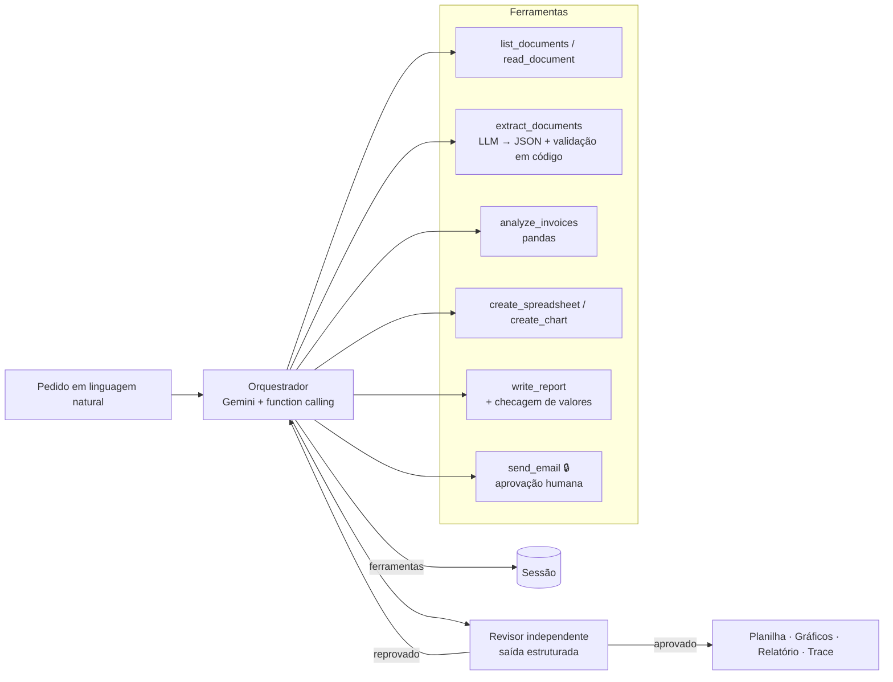

# Arquitetura e decisões

## 1. Um agente com ferramentas + um revisor, e não cinco agentes

O enunciado original previa agentes de Pesquisa, Dados, Documentos, Workflow e Revisão. Avaliei cada um:

| Papel | Virou | Por quê |
|---|---|---|
| Document Agent | ferramenta `extract_documents` | Extrair é uma transformação texto → JSON. Não precisa planejar nem conversar: uma chamada estruturada por documento é mais barata, paralelizável e testável. |
| Data Agent | ferramenta `analyze_invoices` (pandas) | Somar e agrupar é determinístico. Um LLM somando valores é mais lento, mais caro e às vezes erra. |
| Workflow Agent | ferramentas `create_*`, `send_email` | São ações. Quem decide quando executá-las é o orquestrador. |
| Research Agent | fora do MVP | O caso de uso trabalha com documentos internos; pesquisa externa não melhora o resultado. |
| **Reviewer Agent** | **mantido como agente separado** | Aqui a separação tem benefício real: o revisor recebe só o pedido, a análise e o relatório, sem o histórico de raciocínio do orquestrador, o que reduz a tendência de confirmar o próprio trabalho. A saída é estruturada (`aprovado`, `problemas`) e volta para o orquestrador corrigir. |

Resultado: 2 papéis de LLM em vez de 5, menos tokens e menos pontos de falha, sem perder nenhuma capacidade do enunciado.

## 2. O LLM nunca é a fonte dos números

- A **extração** pede ao modelo para copiar valores exatamente como estão no documento, inclusive totais errados.
- A **validação** (soma dos itens, subtotal = qtd × preço, formato de CNPJ, datas, duplicatas) é código.
- A **análise** é pandas. O relatório só pode citar números que existem nela.
- `write_report` extrai todo valor em R$ do texto e confere com a análise. Valores não encontrados voltam como aviso para o agente reescrever. É uma checagem barata e determinística contra alucinação numérica.

## 3. Dados ficam na sessão, não no contexto

Depois da extração, os registros ficam no objeto `Session`. A planilha e os gráficos são gerados a partir dele, então o modelo nunca precisa copiar dezenas de valores para uma chamada de ferramenta (onde poderia trocar um dígito). O contexto do LLM recebe só resumos.

## 4. Segurança operacional

- **Sandbox de arquivos:** leitura só na pasta de entrada e escrita só na de saída (nomes de arquivo vindos do modelo têm o caminho descartado; há teste para path traversal).
- **Ações sensíveis** (`send_email`) passam por um callback de aprovação. O padrão é negar. No modo demonstração, o e-mail vira um `.eml` na pasta de saída, sem envio real.
- **Erros de ferramenta viram resultado**, não exceção: o modelo recebe a mensagem de erro e pode se recuperar.
- **Limite de passos** evita loops.

## 5. MCP

`opsagent-mcp` expõe as mesmas ferramentas por MCP (stdio), além de um *resource* (`analysis://current`) e um *prompt* reutilizável. Assim qualquer cliente MCP (Claude Desktop, Claude Code, IDEs) pode usar a mesma lógica, com o cliente fazendo o papel de orquestrador. A ação sensível não é exposta via MCP.

## 6. Provedor de LLM

O agente depende de uma interface (`LLM.chat`, `LLM.json`), não do SDK. Há um adaptador Gemini e um `ScriptedLLM` usado nos testes, que roda o loop inteiro sem rede. Trocar de provedor é implementar dois métodos.

## 7. Prompts versionados

Os prompts ficam em `src/opsagent/prompts/<nome>_vN.md`. A versão ativa pode ser trocada por variável de ambiente (`OPSAGENT_PROMPT_EXTRACT=v2`), e o benchmark registra quais versões rodou, o que permite comparar resultados entre versões.
