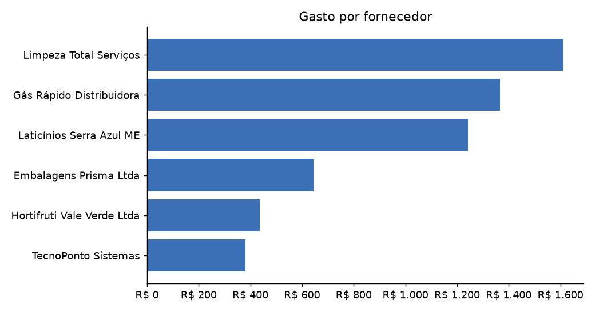
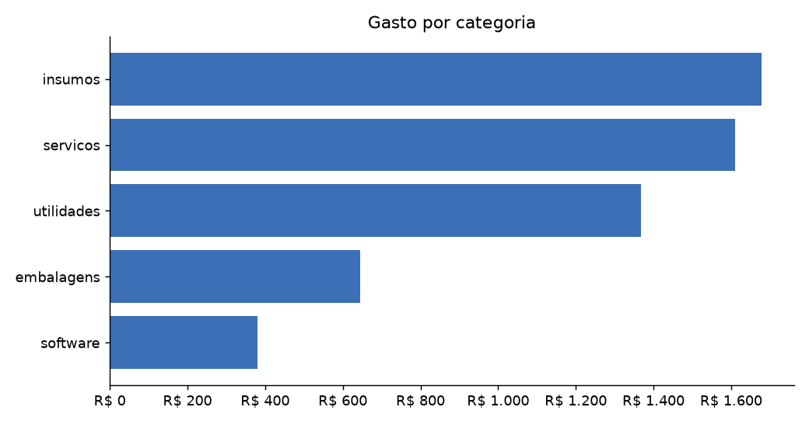
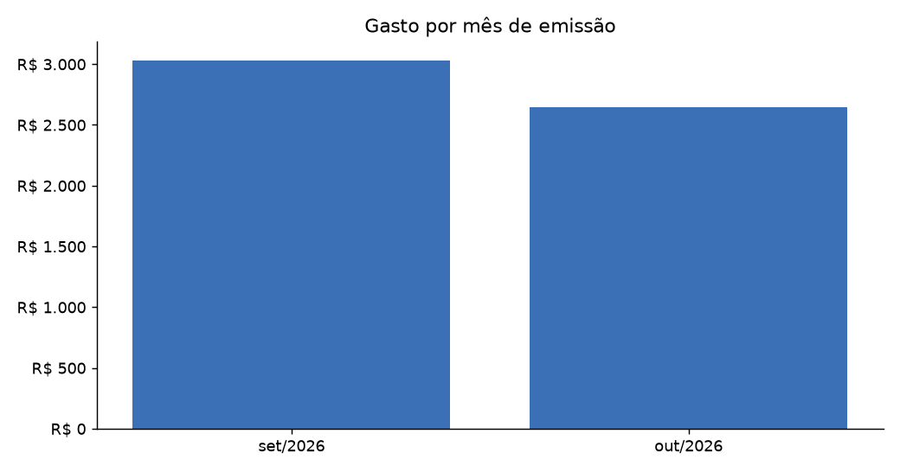

# Relatório Executivo de Análise Financeira

Data de referência: 20:2026-10-20

## Resumo Executivo
- O total geral de faturas válidas analisadas é de R$ 5.678,20, distribuídas entre 15 faturas processadas (ticket médio de R$ 378,55).
- Há um volume expressivo de faturas vencidas totalizando R$ 3.303,60 que requerem regularização imediata com os fornecedores.
- Foram identificados alertas críticos de divergência de valores e fatura duplicada, exigindo atenção antes de efetuar pagamentos.

## Gastos por Fornecedor e Categoria
### Por Fornecedor
- **Limpeza Total Serviços**: R$ 1.610,00 (maior fornecedor, 28,4% do total)
- **Gás Rápido Distribuidora**: R$ 1.367,00
- **Laticínios Serra Azul ME**: R$ 1.242,40
- **Embalagens Prisma Ltda**: R$ 643,80
- **Hortifruti Vale Verde Ltda**: R$ 435,20
- **TecnoPonto Sistemas**: R$ 379,80

### Por Categoria
- **Insumos**: R$ 1.677,60
- **Serviços**: R$ 1.610,00
- **Utilidades**: R$ 1.367,00
- **Embalagens**: R$ 643,80
- **Software**: R$ 379,80

## Vencimentos Próximos (Próximos 30 Dias)
Total vencendo nos próximos 30 dias: **R$ 2.374,60**
- **Limpeza Total Serviços** (NF-20260004): R$ 480,00 — Vencimento: 2026-10-20
- **Gás Rápido Distribuidora** (NF-20260007): R$ 389,00 — Vencimento: 2026-10-20
- **Hortifruti Vale Verde Ltda** (NF-20260008): R$ 142,60 — Vencimento: 2026-10-22
- **Embalagens Prisma Ltda** (NF-20260009): R$ 434,50 — Vencimento: 2026-11-03
- **Hortifruti Vale Verde Ltda** (NF-20260013): R$ 136,60 — Vencimento: 2026-11-10
- **Laticínios Serra Azul ME** (NF-20260010): R$ 791,90 — Vencimento: 2026-11-18

*(Nota adicional: Há faturas vencidas acumuladas no valor total de R$ 3.303,60 que precisam de atenção urgente).*

## Alertas Críticos
1. **Fatura Duplicada**: `reenvio_NF-20260003.pdf` (Limpeza Total Serviços) é uma duplicata de `nota_NF-20260003.pdf` no valor de R$ 1.130,00. Evitado pagamento em duplicidade.
2. **Divergência de Valores**: `nota_NF-20260099.pdf` (Gás Rápido Distribuidora) apresenta soma de itens igual a R$ 414,00, mas total impresso de R$ 564,00 (diferença de R$ 150,00).
3. **Contrato de Limpeza**: Vigência até 2027-02-28, com reajuste anual pelo IPCA e multa de 10% do valor anual em caso de rescisão antecipada.

## Recomendações Acionáveis
1. **Contatar fornecedores com faturas vencidas** (R$ 3.303,60 em aberto) para renegociação e evitar interrupção de serviços ou suprimentos.
2. **Suspender o pagamento** da NF-20260099 da Gás Rápido Distribuidora até esclarecer a divergência de R$ 150,00 entre os itens e o total impresso.
3. **Descartar a cobrança duplicada** da NF-20260003 da Limpeza Total Serviços (R$ 1.130,00).
4. **Organizar fluxo de caixa** para honrar os vencimentos de R$ 2.374,60 previstos para os próximos 30 dias.

