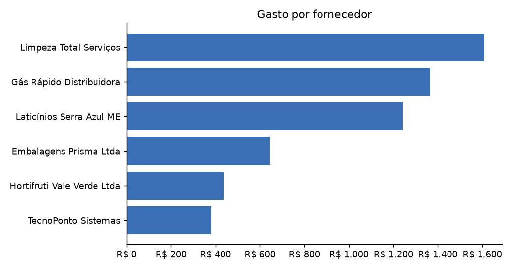
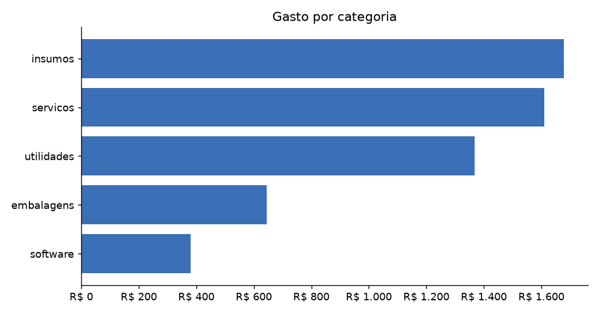

# Relatório Financeiro - Outubro 2026

### Resumo
* **Total Processado:** R$ 5.678,20 em 15 faturas válidas.
* **Maior Fornecedor:** Limpeza Total Serviços (R$ 1.610,00).
* **Atenção:** Há R$ 3.303,60 em faturas vencidas que exigem pagamento imediato.

### Gastos por Fornecedor e Categoria
Os maiores gastos concentram-se em **Limpeza Total Serviços** (R$ 1.610,00) e **Gás Rápido Distribuidora** (R$ 1.367,00). Por categoria, os destaques são **Insumos** (R$ 1.677,60) e **Serviços** (R$ 1.610,00).

### Vencimentos Próximos
Temos R$ 2.374,60 a vencer nos próximos 30 dias, com destaque para as faturas da **Limpeza Total Serviços** (R$ 480,00) e **Gás Rápido Distribuidora** (R$ 389,00), ambas vencendo hoje, 20/10/2026.

### Alertas Críticos
1. **Faturas Vencidas:** Total de R$ 3.303,60. Priorizar pagamentos atrasados para evitar multas.
2. **Divergência:** A nota NF-20260099 (Gás Rápido) apresenta divergência de R$ 150,00 entre o total impresso (R$ 564,00) e a soma dos itens (R$ 414,00).
3. **Duplicidade:** A nota NF-20260003 foi identificada como duplicada (valor de R$ 1.130,00).
4. **Dados Faltantes:** As faturas NF-20260013 e NF-20260014 (Hortifruti Vale Verde) não possuem data de emissão.

### Recomendações
* **Regularização:** Contatar fornecedores para corrigir divergências (Gás Rápido) e solicitar segundas vias com datas (Hortifruti).
* **Pagamentos:** Priorizar a quitação dos débitos vencidos.
* **Contrato:** O contrato de limpeza está vigente até 28/02/2027 com renovação automática; planejar revisão antes do prazo.

